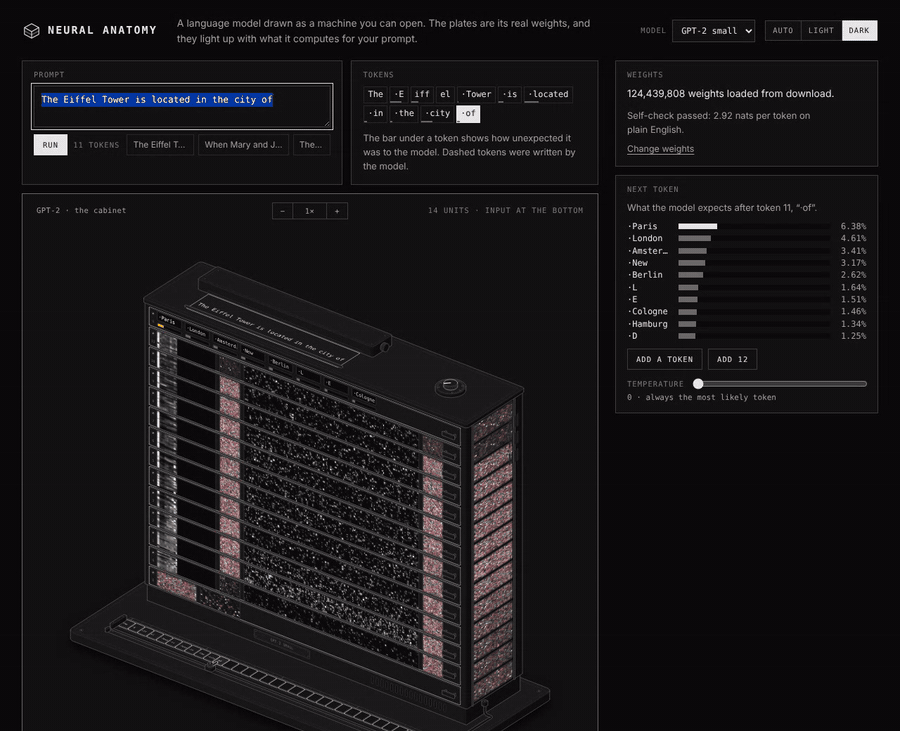
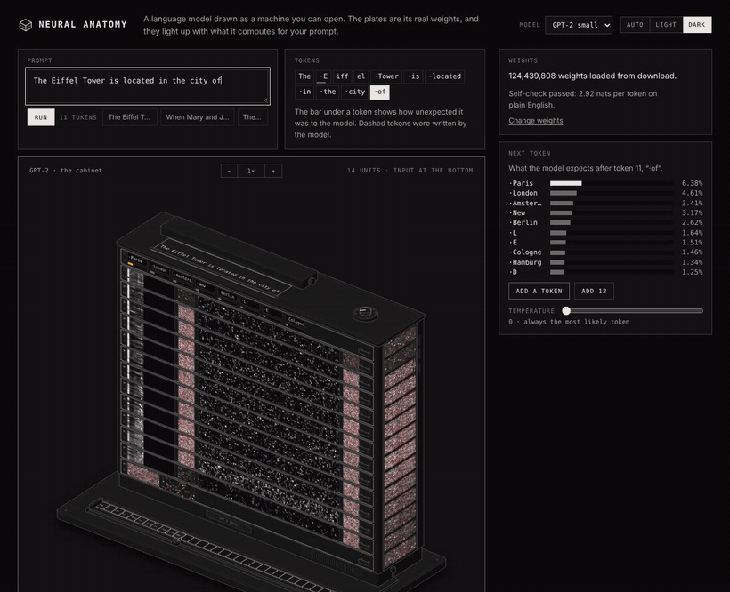
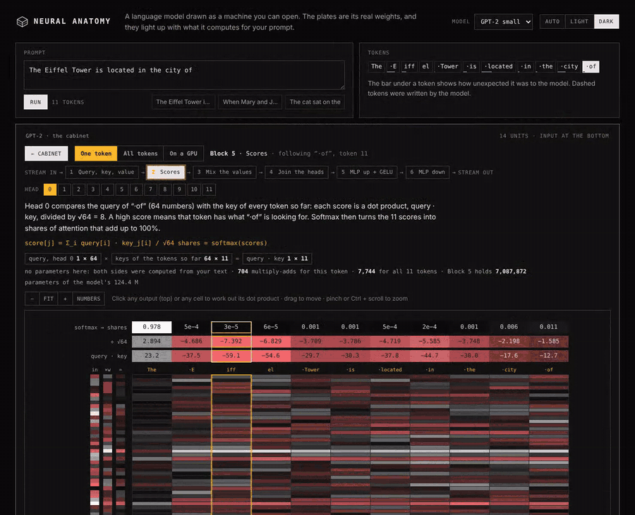
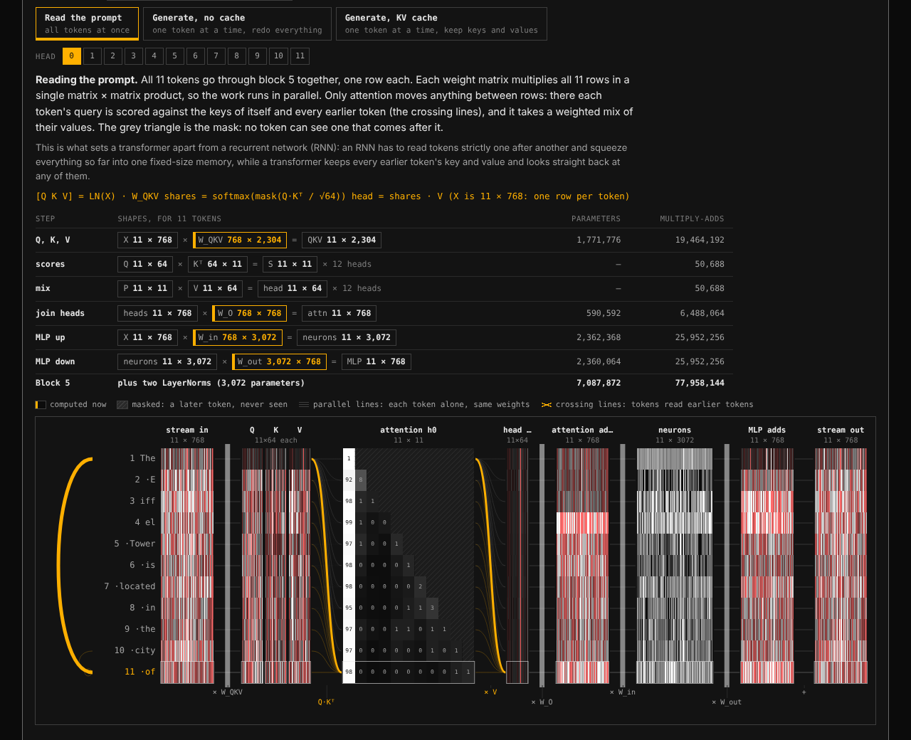
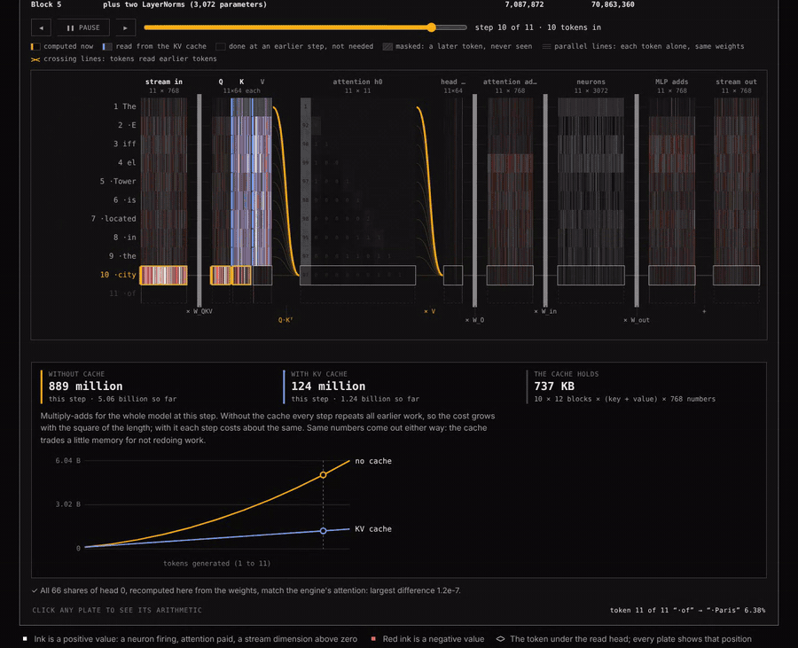
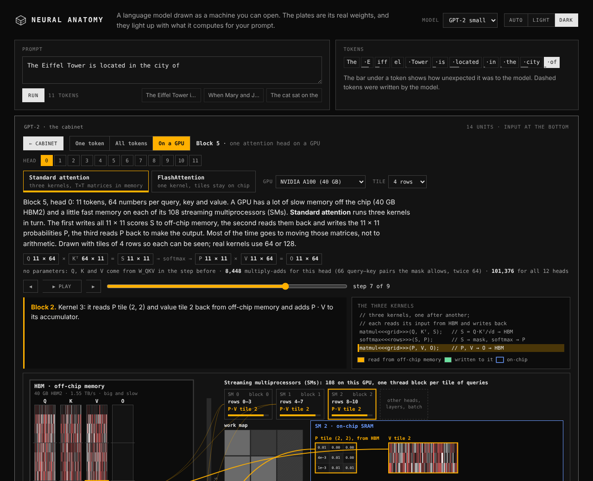
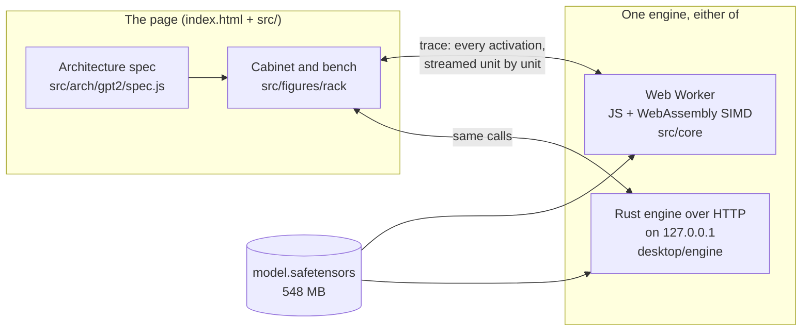

# Neural Anatomy

**A language model drawn as a machine you can open.** Every plate is GPT-2's
real weights, it lights up with what the model actually computes for your
text, and any part of it opens up into the matrix multiplications behind it,
down to a single dot product. It also shows how a GPU runs attention, with and
without FlashAttention.

[](https://github.com/Jakkidi/neural-anatomy/actions/workflows/ci.yml)


[](LICENSE)

**[Try it in your browser](https://jakkidi.github.io/neural-anatomy/)**, or
[run it locally](#run-it) on Windows, macOS or Linux.



*GPT-2 small reads "The Eiffel Tower is located in the city of" and predicts
" Paris". Each module of the cabinet is one unit of the model, and its plates
are that unit's real activations. Every frame in this README was recorded
with OpenAI's released weights.*

---

## What it shows

### 1. The cabinet: the whole model at once

The model is drawn as a machine:
- the input tape at the bottom, then the token embedding;
- the twelve transformer blocks;
- the output at the top, with the next token on its printer.

Each block's front carries:
- its attention, a row per head and a column per token;
- its 3,072 MLP neurons;
- what attention and the MLP add to the residual stream.

The windows up the side are the residual stream itself. Pull a module out to
see all of its weights.

### 2. The bench: every step as a matrix multiplication



Click any plate and the camera flies into it. That unit's work is laid out as
the operations it really does, on your numbers. A block is six steps:

| Step | What it does |
|---|---|
| query, key, value | stream × W_QKV |
| scores | q · k ÷ √64, then softmax, for any head |
| mix the values | shares × values |
| join the heads | × W_O |
| MLP up | × W_in, then GELU |
| MLP down | × W_out |

Each step is drawn as **input vector × matrix = output**. Clicking an output
plays its dot product: the products appear row by row and the running sum
climbs to the value. That value is then **checked against the engine**.

Above each diagram are the operation's sizes:
- the shape of every matrix, with learned weights marked;
- the parameters the step holds;
- the multiply-adds it does, for this token and for the whole text;
- the parameters of the whole block.

Zoom all the way in and every weight and every value is written in its cell.

### 3. All tokens at once, and the KV cache



**All tokens** shows a block for every token of the text at once, one row per
token:

- **Parallel lines** mean each token is processed alone, by the same weights.
  This is one matrix × matrix product for the whole text.
- **Crossing lines** mean tokens read from earlier tokens. That happens only in
  attention, and only backwards: the grey triangle is the causal mask.

There are three ways to run it:

- **Read the prompt**: every row at once.
- **Generate without a cache**: every earlier token is run again at each step.
- **Generate with a KV cache**: only the new row is computed. Earlier keys and
  values (blue) come from memory.

A meter counts the multiply-adds for the whole model each way. For this text:
- 1.36 billion with the cache;
- 6.04 billion without it;
- 974 million to read it in one pass.

A table lists every matrix product of the block with its shapes, parameters and
work:



### 4. On a GPU: standard attention against FlashAttention



One attention head of the block, run the way a graphics card runs it, on the
head's real numbers. The view has three parts:
- on the left, the GPU's large, slow off-chip memory (HBM);
- on the right, its streaming multiprocessors (SMs), one thread block per tile
  of queries;
- the small, fast on-chip memory (SRAM) of the SM you follow.

You can step through it:

- **Standard attention** runs three kernels. It writes the whole T × T score
  matrix S to HBM, reads it back for the softmax, then writes P and reads it
  back again.
- **FlashAttention** runs one kernel. Each thread block keeps its query tile on
  chip and walks through the key and value tiles. It keeps a running max *m*
  and a running sum *l* (online softmax), so S and P never leave the chip.
  Tiles in the future are skipped.

Beside the view:
- the CUDA-style kernel, with the current line lit;
- the rescaling, written out with the real numbers (for example
  `l = 3.841 × 0.9606 + 3.684 = 7.374`);
- HBM traffic counted both ways;
- a table that scales the traffic to 1,024, 8,192 and 131,072 tokens on an
  A100, H100 or RTX 4090.

Run to the end, FlashAttention's output equals ordinary attention to about
1e-7: online softmax is exact.



---

## Run it

There are two ways to run it, and they show exactly the same figures:

| | Browser version | Desktop app |
|---|---|---|
| Engine | JavaScript + WebAssembly SIMD in a Web Worker | Rust, native threads, AVX2 / NEON |
| Needs | [Node.js 20+](https://nodejs.org) and a modern browser | nothing; the launcher installs Rust the first time |
| Weights | downloaded once into the browser's storage | downloaded once to disk |
| Speed (11-token prompt) | about 0.2 s | about 0.1 s |

Neither has any package dependencies: no `npm install` and no crates to
download.

### Browser version (any OS)

```bash
git clone https://github.com/Jakkidi/neural-anatomy.git
cd neural-anatomy
npm start
```

Open <http://localhost:4173> and press **Load weights**. You can also use the
[hosted copy](https://jakkidi.github.io/neural-anatomy/).

`npm start` runs `serve.mjs`, a 50-line static server. Any static server works
(`python3 -m http.server 4173`, for example). Opening `index.html` directly
does not work, because browsers will not start a worker from a `file:` page.

### Desktop app

Clone the repository (or download the ZIP from the green **Code** button),
then:

| | |
|---|---|
| **Windows 10 / 11** | Double-click **`Start Neural Anatomy.cmd`**. |
| **macOS** | Double-click **`Start Neural Anatomy.command`**. If macOS blocks it, right-click it and choose **Open**. |
| **Linux** | Run `./"Start Neural Anatomy.command"` in a terminal. |

The first time, the launcher installs Rust for your user only. That is about
300 MB, needs no admin rights, and on Windows needs no Visual Studio. On a Mac
it first asks to install Apple's command line tools. The launcher then builds
the app, which takes a minute or two. Later starts take a few seconds.

The app opens in a window of its own when Chrome, Edge, Brave or Chromium is
installed, and in your default browser otherwise.

By hand, with [Rust](https://rustup.rs) installed:

```bash
cd desktop
cargo run --release
```

Prebuilt programs for Windows, macOS (Apple silicon and Intel in one file) and
Linux are attached to each
[release](https://github.com/Jakkidi/neural-anatomy/releases). Every push is
built and tested on all three systems by
[CI](https://github.com/Jakkidi/neural-anatomy/actions).

More options, where files are kept, and how the desktop app is put together:
[desktop/README.md](desktop/README.md).

### The weights

The app uses OpenAI's published GPT-2 small, `model.safetensors` (548 MB), from
[Hugging Face](https://huggingface.co/openai-community/gpt2). No account is
needed. It is downloaded once and loads in about a second after that.

- **Use a file** (or drag the file onto the page) loads a copy you already
  have.
- **Random weights** fills the same machine with noise, to try the interface
  without the download.

Each time real weights load, the app runs a paragraph of English through the
model and reports how well it predicts it. That way you know the weights are
real and the engine runs them correctly.

---

## Does it compute the right thing?

Yes, and it checks itself. Both engines, run on the real weights:

```
"The Eiffel Tower is located in the city of" (11 tokens)
    6.38%  " Paris"
    4.61%  " London"
    3.41%  " Amsterdam"
    3.17%  " New"
    2.62%  " Berlin"

On 60 tokens of plain English: 2.92 nats per token   (GPT-2 small: about 3 to 4; random: 10.8)
PASS: these are trained weights and the engine runs them correctly.
```

| Check | Against | Agreement |
|---|---|---|
| Every traced activation and logit, both engines | an independent numpy GPT-2 (`tools/reference_gpt2.py`) | 2e-6 |
| Tokenizer | token ids published for GPT-2, and 9,242 strings across both engines | identical |
| Every number on the bench (neurons, attention, MLP, stream) | the engine's own trace | 2e-6 |
| FlashAttention, causal and not, uneven tiles | plain softmax attention | 1e-7 |
| Appending tokens one at a time (KV cache) | running the whole prompt again | same prediction |

```bash
npm test                                         # tokenizer, engine vs numpy (needs python3 + numpy), FlashAttention
node tools/verify-real.mjs                       # the real weights (downloads them)
cd desktop && cargo test --release               # the Rust engine vs numpy
cargo run --release -- --check                   # the real weights, from the terminal
```

---

## How it works



- **The engine** streams the checkpoint into memory and runs the forward pass.
  It posts every unit's activations to the page as it finishes them (the
  *trace*), which is why the cabinet lights up unit by unit.
- **The page** never computes the model itself. The bench redoes each step it
  shows from the weights and compares its result with the trace, which is how
  each diagram proves it is drawing the real computation.
- **The spec** is pure data: the model's units, the activations each one
  exposes and where its weights live. The figures are drawn from the spec, not
  from GPT-2-specific code. The browser and desktop versions share the page,
  and only the engine differs: `src/core/client.js` or
  `src/core/native-client.js`, which have the same interface.

### Built to take more architectures

A new model of an existing architecture is one line in `src/models/index.js`.
A different-sized GPT-2 dropped on the page is read from its own config, and
the cabinet is rebuilt to match.

A new architecture is a folder in `src/arch/` with its engine half and its
spec, plus two registry lines. The **All tokens** and **On a GPU** views only
need the spec to say where its attention lives, and they already handle:
- bidirectional models (BERT, ViT);
- grouped-query attention;
- RMSNorm;
- separate Q, K and V matrices.

[docs/ADDING_AN_ARCHITECTURE.md](docs/ADDING_AN_ARCHITECTURE.md) walks through
it, including what image and multi-modal models still need.

### Project layout

```
index.html  serve.mjs          the page, and a static server with no dependencies
src/
  app.js                       state, controls and wiring
  models/index.js              model cards
  arch/gpt2/                   GPT-2: forward pass and tokenizer (engine side), spec.js (page side)
  core/                        architecture-free engine: worker, WASM kernels, safetensors, weight store
  figures/rack/                the cabinet
    bench/                     the bench
      ops.js  view.js          one token: each step as vector × matrix, and its canvas
      sequence*.js             all tokens at once, generation with and without the KV cache
      heads.js                 one head's Q, K, V for any architecture
      dims.js                  shapes, parameters and multiply-adds for the text above each diagram
      gpu/                     attention on a GPU: standard and FlashAttention, devices, kernel
  ui/                          card, zoom stage, plates, styles
desktop/
  engine/                      the Rust engine (std only)
  app/                         the desktop program: HTTP server, window, downloads, --check
assets/gpt2/                   GPT-2's vocabulary and merges
vendor/anatomy/                the Anatomy drawing kit (MIT)
test/  tools/  docs/
.github/workflows/             CI on Windows, macOS and Linux; releases; GitHub Pages
```

### URL options

| Parameter | Effect |
|---|---|
| `?weights=<url>` | read the weights from a mirror or a local copy |
| `?theme=light` | `light`, `dark` (default) or `auto` |
| `?model=gpt2-bench` | start on another model card |
| `?noauto` | do not load the saved copy on arrival |
| `?nowasm` | use the plain JavaScript kernels |

---

## Credits

- The drawing style and kit are from [Anatomy](https://github.com/wheresryan22/anatomy)
  by Ryan (MIT), in `vendor/anatomy/`.
- GPT-2 and its vocabulary are by OpenAI
  ([modified MIT](https://github.com/openai/gpt-2/blob/master/LICENSE)). The
  weights are not in this repository.
- FlashAttention: Tri Dao, Daniel Y. Fu, Stefano Ermon, Atri Rudra and
  Christopher Ré, [*FlashAttention: Fast and Memory-Efficient Exact Attention
  with IO-Awareness*](https://arxiv.org/abs/2205.14135) (2022). The GPU figures
  are NVIDIA's published specifications, rounded.

Third-party material is listed in [NOTICE.md](NOTICE.md). The project itself
is under the [MIT licence](LICENSE).
